# Tibbou User Manual

**Version:** 1.2  
**Team Number:** Team 3  
**Team Name:** Data Cost Management System (Tibbou)  
**Date:** 10/11/2026

## 1. Introduction

Tibbou helps data engineers, analysts, and administrators understand how datasets are connected and where warehouse spending occurs. It displays a data lineage map, which shows the flow from sources through processing steps to finished datasets, alongside saved costs and available Snowflake usage credits. Tibbou reads Snowflake information and stores imported information and organization membership changes in its own database.

## 2. System Requirements

- **Hardware:** A desktop or laptop computer with an internet connection.
- **Operating system and software:** An operating system with a web browser that supports JavaScript, cookies, and secure HTTPS websites.
- **Account:** A Tibbou account and approved membership in your team's organization. An organization is the shared workspace for your team.
- **Data:** Your team's administrator or data engineer supplies the connected Snowflake information and dbt files. You do not need to install database software to view information already loaded into Tibbou.

## 3. Installation Guide

**No installation required. Tibbou is a hosted web application.**

1. Open your web browser.
2. Visit [Tibbou](https://d3ds9xfujeetf5.cloudfront.net/).
3. Bookmark the website so you can return to it later.

## 4. Getting Started

1. Open [Tibbou](https://d3ds9xfujeetf5.cloudfront.net/).
2. If you do not have an account, choose **Create account**, enter your work email and a password, and submit the form. If email confirmation is requested, follow the confirmation email before signing in.
3. Choose **Sign in**, enter your **Work email** and **Password**, and select **Sign in**. Alternatively, choose **Continue with Microsoft** and follow the sign-in prompts when that option is enabled.
4. If you see **No organization membership found**, ask an owner or administrator to invite the same email address you use to sign in. When an invitation appears, select **Join organization**. Creating an account alone does not grant access to your team's data.
5. After joining, start on **Dashboard**. The organization selector at the top identifies your current workspace; choose another organization there if you already belong to more than one.
6. Use the left menu to open **Datasets**, **Lineage**, and **Costs**. **Members** and **Connection** are administrative areas; available actions depend on your role.
7. When finished, select the **Sign out** icon at the top right.

The screenshots below show the hosted application and its sample workspace. Your organization's names, counts, dates, and available data may differ. Some screenshots use the collapsed sidebar to make the content easier to read; use the arrow at the bottom of the left menu to expand it again.

## 5. Features and Functions

### Feature 1 Signing in and creating an account

**What it does:** Establishes your account and lets you access organizations that have approved your membership.

1. Use **Create account** for a new email/password account, or **Sign in** for an existing one.
2. Enter your work email and password, then select the matching submit button.
3. Follow any email-confirmation instructions. For Microsoft sign-in, select **Continue with Microsoft** and follow the provider's prompts.
4. If an error appears, check your details and retry. **Okta — Coming soon** is unavailable.

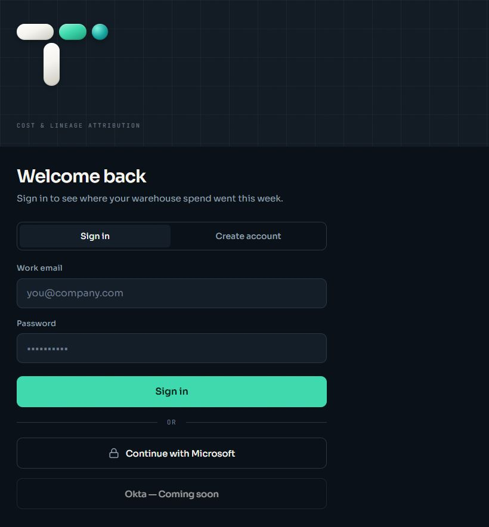

*Figure 1. Sign in with an existing account.*

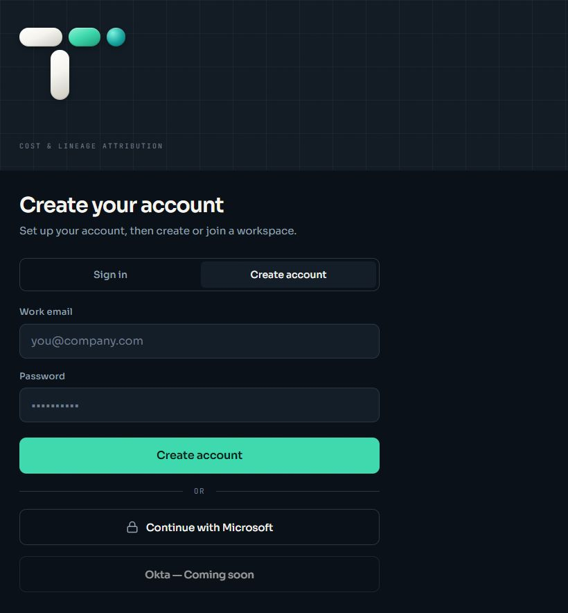

*Figure 2. Create account opens a separate form for a new account.*

### Feature 2 Dashboard overview

**What it does:** Summarizes the datasets, relationships, and saved costs in the selected organization.

1. Select **Dashboard** from the menu.
2. Read **Datasets**, **Lineage edges**, **Cost snapshots**, and **Recorded cost**. A lineage edge is a relationship connecting two datasets.
3. Scroll down to review **Recent datasets**, **Connected data flows**, **System coverage**, and **Recent cost snapshots**.
4. Open the corresponding menu page to explore a topic further. Recorded cost totals reflect saved records, rather than a complete current Snowflake bill.

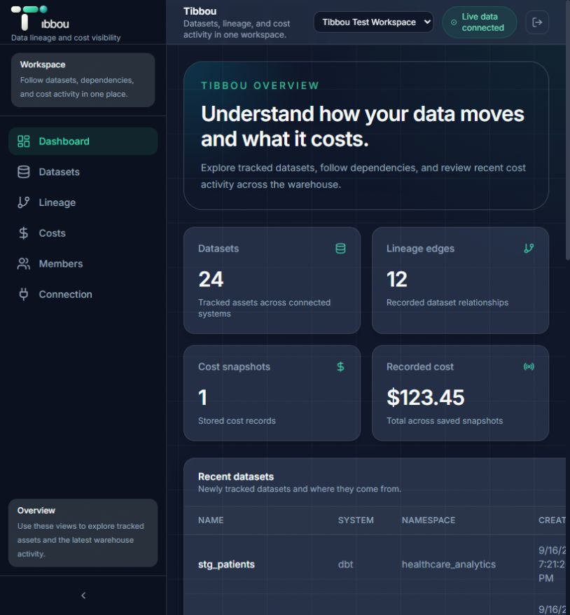

*Figure 3. Dashboard summary cards.*

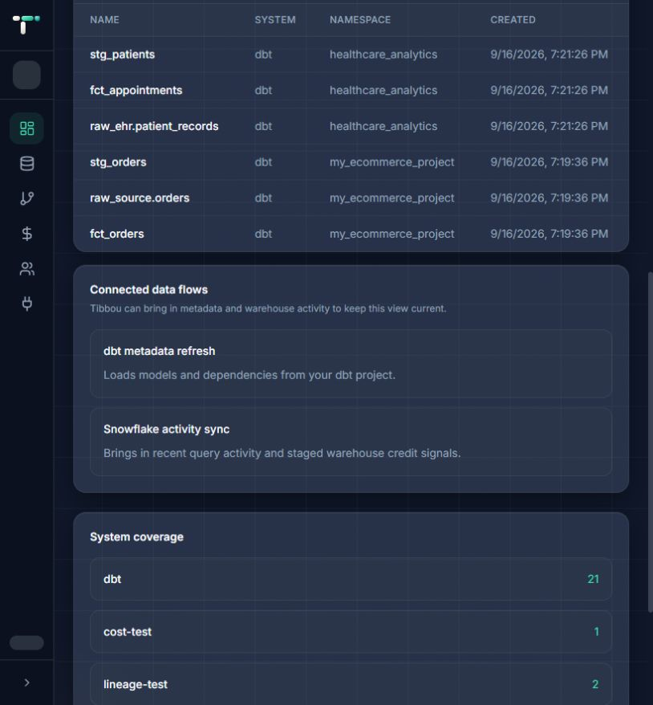

*Figure 4. Additional overview information below the cards.*

### Feature 3 Finding datasets

**What it does:** Lists the datasets currently tracked in your organization. A dataset is a named collection of data; its namespace identifies the project or source grouping.

1. Open **Datasets**.
2. Enter part of a name or namespace in **Search name or namespace...**.
3. Use **All systems** to restrict the list to a system, such as **dbt**.
4. Read the matching rows. Clear the search and return to **All systems** to see the full list. For wide tables, scroll horizontally to see remaining columns.

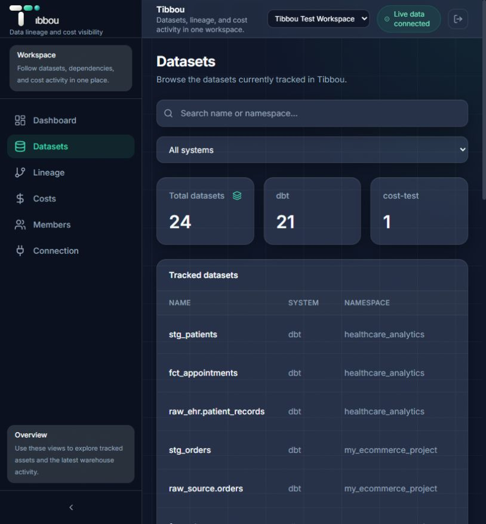

*Figure 5. Dataset browsing controls.*

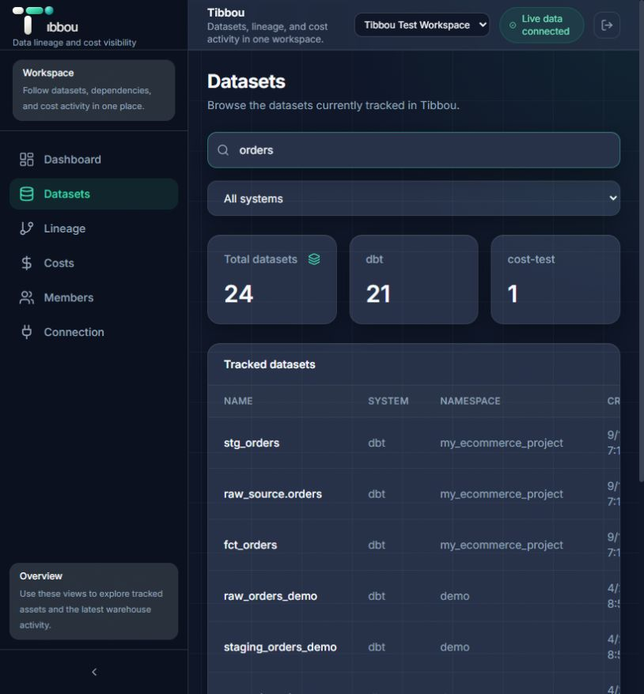

*Figure 6. Searching for orders narrows the visible rows.*

### Feature 4 Exploring the lineage map

**What it does:** Shows arrows between sources, transformations, and destinations. A transformation is a step that prepares or combines data.

1. Open **Lineage** and scroll to **Current lineage graph**.
2. Enter a dataset name in **Search dataset names...**, or choose a system from **All systems**.
3. Follow arrows from a source toward its downstream datasets. Click a dataset box to highlight its connections and open its details panel. **Upstream** lists datasets feeding into it; **Downstream** lists datasets that depend on it. Select **Close details** to dismiss the panel.
4. Use **Zoom in**, **Zoom out**, and **Reset** to adjust the graph. Drag an empty area of the canvas to move the view.

If the graph is empty, clear the filters first; datasets without a stored relationship do not appear in the graph.

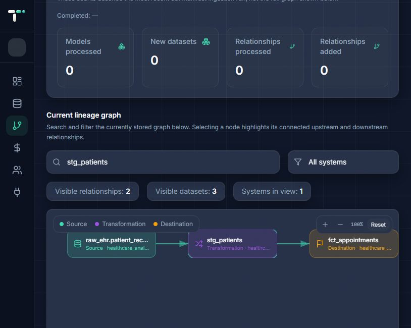

*Figure 7. A filtered graph shows the flow through one dataset.*

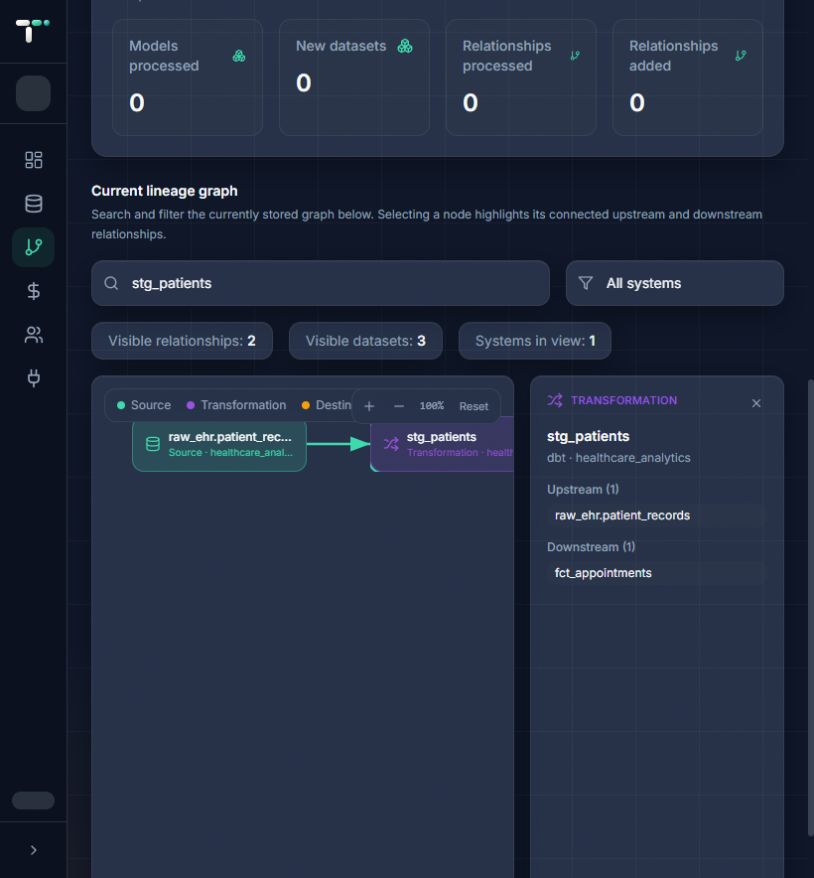

*Figure 8. Selecting a node highlights its connections and opens its details.*

### Feature 5 Refreshing dbt information

**What it does:** Imports a dbt manifest, a JSON file describing datasets and their dependencies, to update Tibbou's stored lineage information. Owners, administrators, and operators can request this refresh; viewers cannot.

1. Ask your data engineer for the correct **manifest.json** for this organization.
2. Open **Lineage** and find **Ingest dbt manifest**.
3. Select **Load JSON file** and choose the file, or paste its complete contents into the text area.
4. Select **Run dbt manifest refresh**. A queued message means processing has been requested; it does not mean the import is complete.
5. Refresh the page after processing, then check **Latest dbt metadata refresh** and the graph. The summary describes the latest import, rather than every dataset in the organization.

Use your team's approved file: importing changes Tibbou's stored dataset and relationship information. Ask your administrator for help if an error appears or completion information does not update.

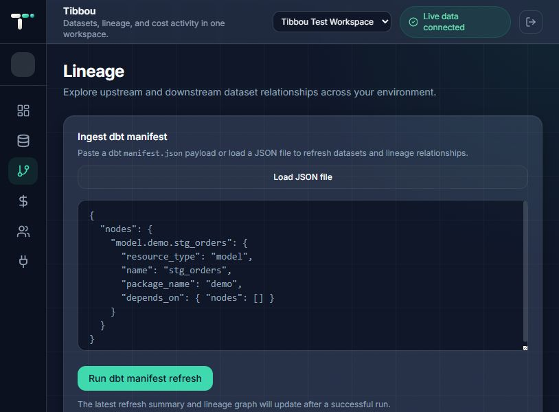

*Figure 9. The import form; the displayed JSON is the application's example placeholder.*

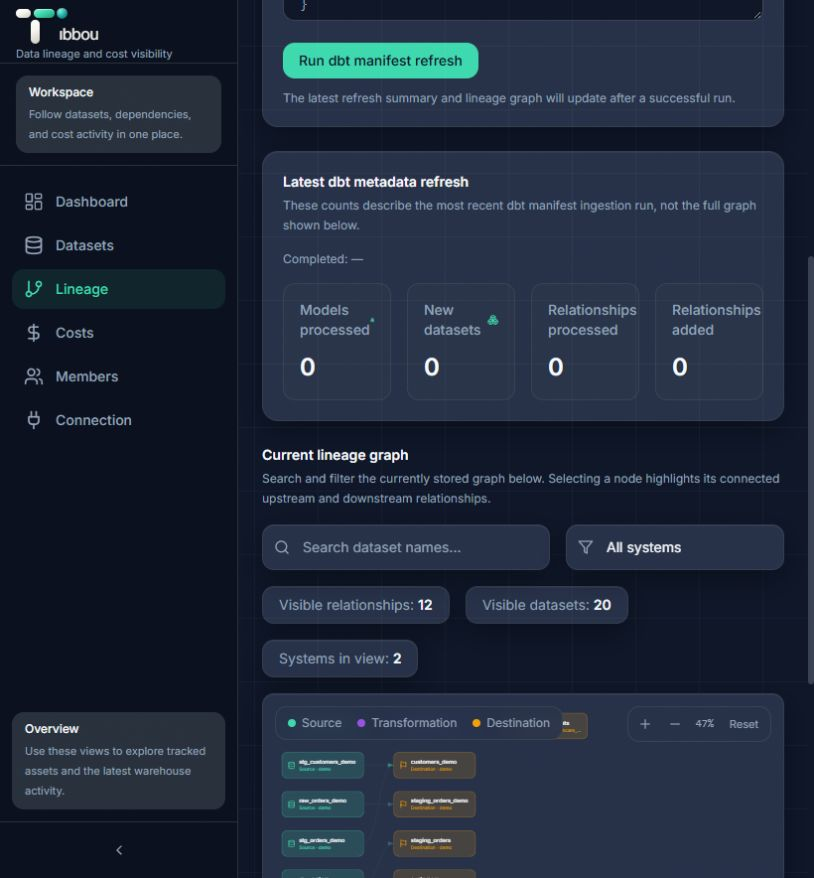

*Figure 10. Refresh summary panel. A missing completion date does not confirm a completed import.*

### Feature 6 Reviewing costs and Snowflake credits

**What it does:** Displays saved dollar-cost records and any available dataset-level Snowflake credit summaries. Credits measure Snowflake usage; they are not dollar amounts.

1. Open **Costs**.
2. Review **Total recorded cost** and **Highest-cost datasets** to compare saved costs.
3. Read **Stored cost snapshots** for each record's dataset, period, amount, and collection date.
4. Scroll to **Latest staged Snowflake dataset credit summaries**. Check the bounded period, **Compute credits**, **Query accel.**, and **Queries**. Query acceleration is additional processing used to speed up supported queries.

Dataset attribution divides measured query credits among matched datasets; it is an estimate of contribution. Query credits exclude idle warehouse time and other Snowflake charges. An empty credit table or a dash means information is unavailable, rather than proof of zero spending; ask your administrator to check the connection and imported usage.

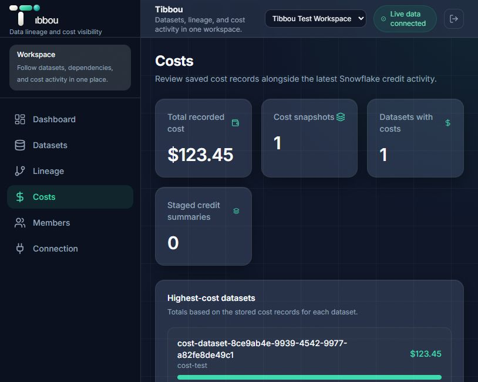

*Figure 11. Saved dollar-cost overview.*

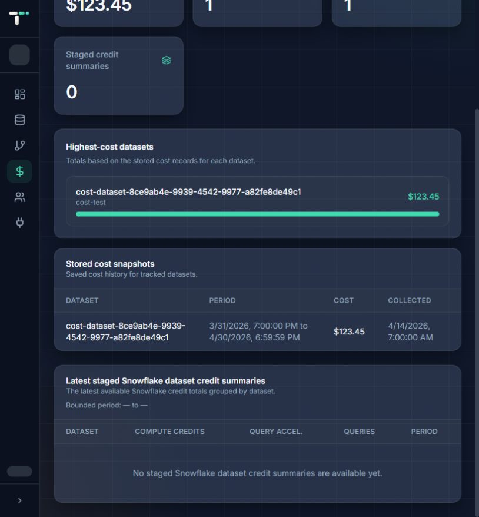

*Figure 12. Saved costs and a credit table with no summaries available in this sample workspace.*

### Feature 7 Members and invitations

**What it does:** Lets owners and administrators review access to their organization and invite members.

1. Open **Members** and review your role and **Organization memberships**.
2. In **Invite a member**, enter the person's exact sign-in email and choose **Viewer**, **Operator**, or, for an owner, **Admin**.
3. Select **Create invitation**, then tell the person to sign in and select **Join organization** when the invitation appears. Tibbou does not automatically send an invitation email.
4. Review **Pending invitations**. An **Expired** invitation cannot be accepted; an authorized administrator can revoke it and create a replacement. **Revoke** cancels a pending invitation.
5. Where your role permits, the membership table offers a role selector, **Make owner**, and **Remove**. These change access; use them only for the intended member and follow any confirmation or error message.

Viewers browse information; operators can also request imports; administrators manage invitations and connections; owners have additional authority, including inviting administrators. These are organization roles, separate from whether someone signs in through email or Microsoft. Members has no activity-log view.

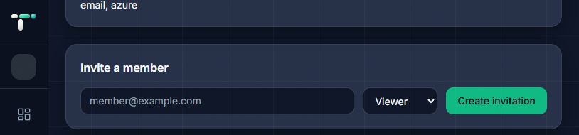

*Figure 13. Invitation controls.*

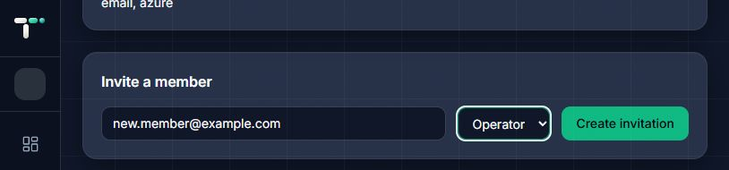

*Figure 14. An example invitation prepared for an operator; it has not been submitted.*

### Feature 8 Snowflake connection

**What it does:** Shows connection status and provides setup controls for authorized administrators. Connecting Snowflake requires help from your data engineer; ordinary users can view already imported information without setting up a connection themselves.

1. Open **Connection** and inspect **Connections**, including status, **Last verified**, and **Last successful sync**. A pending or disabled connection is not ready to supply new usage data.
2. If your team needs a connection, select **Add a new connection** and give the displayed setup instructions to your data engineer.
3. Have the engineer complete the account, user, role, warehouse, and authentication fields using your team's approved credentials. The form offers **Key pair (recommended)** and **External OAuth**.
4. The authorized administrator can use **Test connection** and then **Save connection**. Read the result before continuing; use **Cancel** to abandon an unsaved setup.

A saved connection alone does not establish that fresh usage has been imported. Ask your administrator to arrange synchronization and check the latest successful sync. Keep private keys and other credentials out of screenshots and support messages.

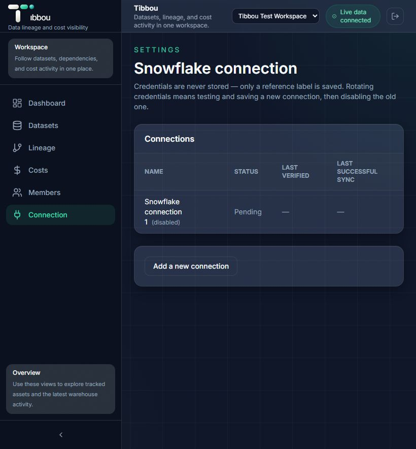

*Figure 15. Connection status in the sample workspace.*

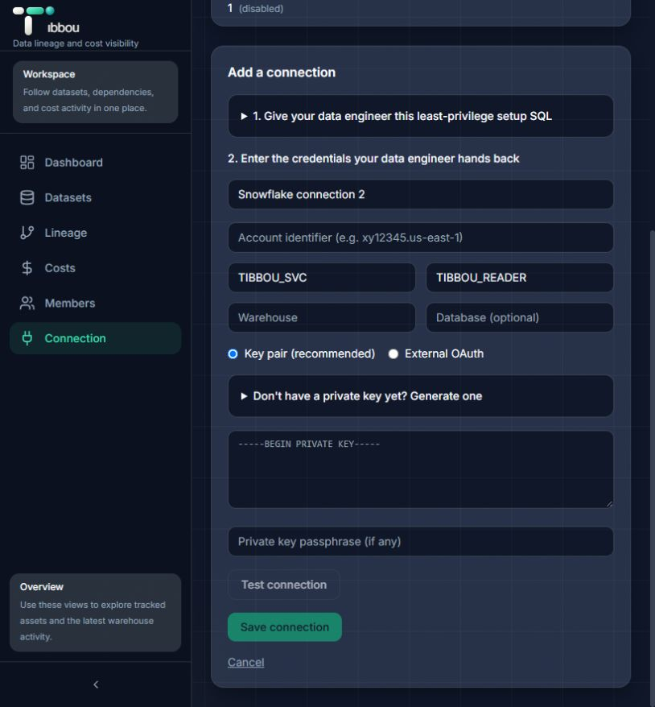

*Figure 16. Setup form before credentials are entered.*

## 6. Troubleshooting

| Problem | Possible cause | What to do |
|---|---|---|
| The website will not open | The address is incorrect, your internet connection is unavailable, or the hosted service is down. | Check the website address in Section 3 and try another website. If your connection works, retry later and report the issue to your team's support contact. |
| Sign-in fails | Incorrect credentials, an unconfirmed email, or a sign-in service problem. | Check your email spelling and password. Follow any confirmation email, retry, and contact support if the problem continues. |
| Microsoft sign-in fails or is unavailable | Your account or the provider's setup does not allow the sign-in attempt. | Use your existing email/password account if available, or ask the administrator to check Microsoft access. Okta is not available. |
| No organization membership found | An account exists, but access has not been approved or the invitation uses a different email. | Ask an owner or administrator to invite your sign-in email. Choose Join organization when the invitation appears. |
| An invitation is missing or expired | The address differs, the invitation expired, or the current screen does not show invitations for another organization. | Give the administrator your sign-in email and ask them to check or replace the invitation. If you already belong to a workspace, ask them to help with access to another one. |
| Members, Connection, or an import action reports insufficient permission | Your organization role does not allow the action. | Ask an owner or administrator to review the access you need. Signing in with Microsoft does not grant extra permissions. |
| The lineage graph is blank | Filters exclude relationships, the view is moved or zoomed, or no relationships have been imported. | Clear the search, choose All systems, and select Reset when the graph is present. Ask your administrator to check imported lineage if it remains empty. |
| A refresh is queued but the data does not change | Background processing has not completed or failed. | Reload the page and check the refresh summary. Report the error or unchanged completion information to the administrator; avoid repeatedly submitting the same file. |
| Credits are empty or dates show a dash | Usage summaries have not been published, the connection is not ready, or attribution information is unavailable. | Ask the administrator to check connection verification and synchronization. Do not interpret missing information as zero cost. |
| A page reports unavailable data or an expired session | A service request failed or your sign-in session expired. | Reload once. Sign in again if requested; otherwise report the page name and visible error to support. |

## 7. Contact Information

- **Support Email:** Help@tibbou.com
- **Website:** [Hosted Tibbou application](https://d3ds9xfujeetf5.cloudfront.net/)
- **Project Repository:** [Tibbou on GitHub](https://github.com/Zainab06Syeda/Tibbou)
- **Account and organization access:** Contact your organization's owner or administrator.

For support, include the affected page, the visible error message, and the steps that caused the problem. Do not send passwords, private keys, or sign-in tokens.

## 8. FAQ

**Do I need to install anything or keep a terminal open?**  
No. Open the hosted website in a browser; the service runs remotely.

**Does creating an account give me access to my team's data?**  
No. Organization membership is separate from your sign-in account. Ask your owner or administrator for access.

**Can Tibbou change my Snowflake datasets?**  
Its usage and lineage collection reads Snowflake information. Imports and member administration update Tibbou's own stored information; initial Snowflake access is configured by your data engineer.

**Are Snowflake credits the same as my total bill?**  
No. Credits measure usage, and the dataset report covers query-related credits rather than every Snowflake charge. Saved dollar-cost records are displayed separately.

**Why can I see datasets but no lineage graph?**  
The graph needs relationships, not just datasets. Clear filters first, then ask your administrator whether the required lineage has been imported.

**Can other organizations see my workspace?**  
Access is based on approved organization membership. The organization selector shows workspaces available to your account; signing in through a different provider does not grant access to other organizations.
